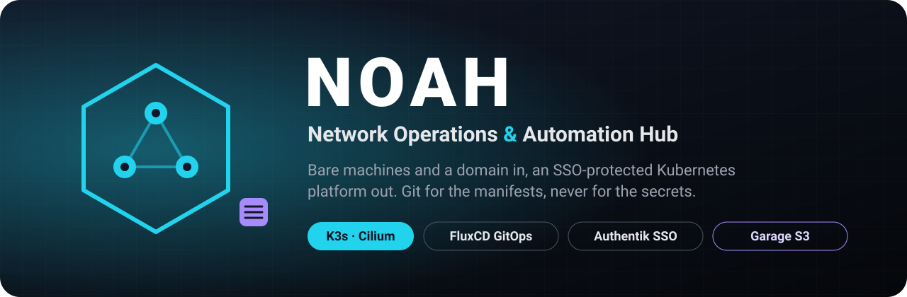
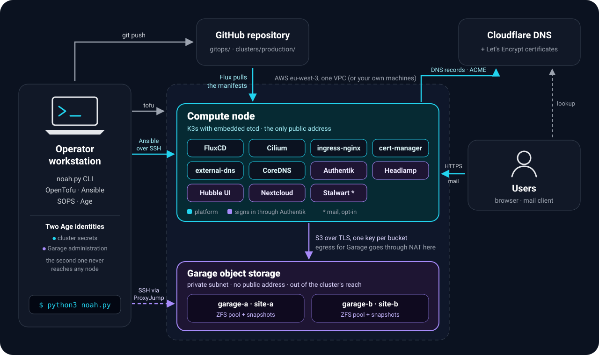
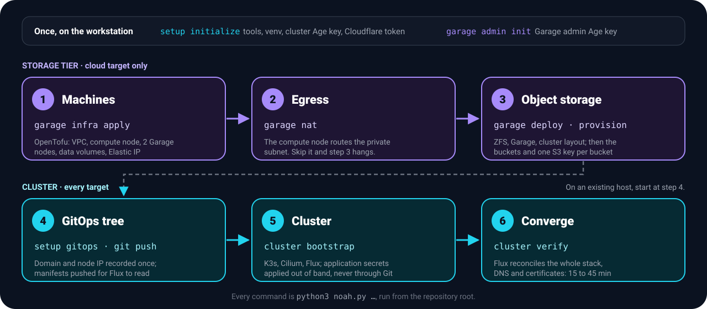
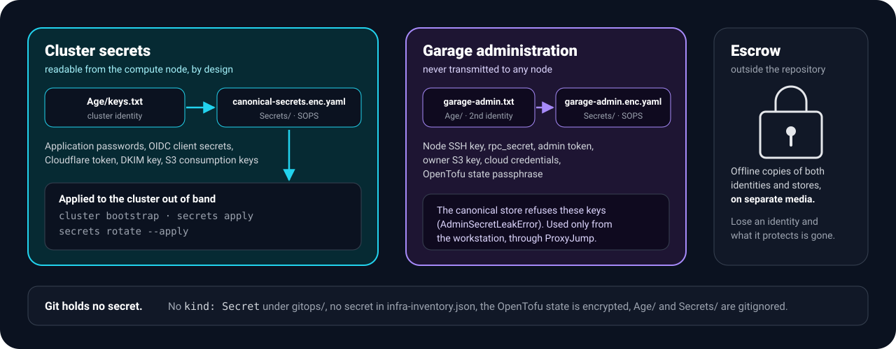

<p align="center">
  
</p>

<p align="center">
  <a href="LICENSE"></a>
  <a href="https://github.com/Engelnicolas/NOAH/releases"></a>
  
  
  
  
</p>

# NOAH: a Kubernetes platform from one CLI

**Give NOAH a domain and machines; get back an SSO-protected, HTTPS-terminated,
GitOps-reconciled Kubernetes platform, with its object storage kept out of the cluster's
reach.** One Python CLI drives OpenTofu for the machines, Ansible for their contents and
FluxCD for everything that runs on the cluster. Git holds the manifests; the secrets never
go near it.

<p align="center">
  <a href="#getting-started"><b>Getting started</b></a>
  &nbsp;·&nbsp;
  <a href="docs/DEPLOYMENT_GUIDE.md">Deployment Guide</a>
  &nbsp;·&nbsp;
  <a href="docs/OPERATIONS_GUIDE.md">Operations Guide</a>
  &nbsp;·&nbsp;
  <a href="docs/README.md">All docs</a>
</p>

## Why NOAH

| | |
|---|---|
| 🧭 **One entry point** | `python3 noah.py` for everything. The domain and node IP are recorded once, then reused as defaults by every later command. |
| 🔁 **GitOps for real** | FluxCD reconciles `gitops/` continuously. You change the platform with `git push`, not `kubectl apply`. |
| 🔐 **Secrets never in Git** | A SOPS/Age-encrypted store is the single source of truth; secrets reach the cluster out of band. |
| 🪪 **Single sign-on everywhere** | Authentik fronts Headlamp, Hubble, Nextcloud and Stalwart: one login, OIDC or forward-auth. |
| 🌐 **DNS and TLS on autopilot** | external-dns writes the Cloudflare records, cert-manager gets Let's Encrypt certificates. |
| 🛡️ **Storage out of reach** | Garage, the S3 tier, runs on separate machines in a private subnet with its own keys. A compromised cluster cannot erase its backups. |
| ☁️ **Machines as code** | OpenTofu creates the AWS target (Spot, one zone, encrypted state); bare metal uses the same hand-written inventory file. |
| ✉️ **Mail, if you want it** | Stalwart (SMTP, IMAP, JMAP) is opt-in, signs users in through Authentik and relays the platform's notifications. |

## How it works

<p align="center">
  
</p>

The **workstation** is the only place that holds every key. It creates the machines with
OpenTofu, then configures them with Ansible over SSH: K3s, Cilium and Flux on the
**compute node**, ZFS and Garage on the **storage nodes**, which it reaches through the
compute node as a jump host with a key the cluster never sees.

From then on, **Git drives the cluster.** Flux pulls `clusters/production/` and `gitops/`
from GitHub and reconciles them in four ordered stages: infrastructure, certificate
issuers, applications, extra applications. Application secrets are rendered from the
encrypted store and applied directly, never committed.

**Every web application signs in through Authentik.** external-dns publishes each
hostname in Cloudflare, cert-manager obtains its certificate, and ingress-nginx serves it
on the node's ports 80 and 443. Applications that need object storage get one S3 key per
bucket on Garage, over TLS; granting write in Garage grants delete, which is why the
Garage nodes keep ZFS snapshots the cluster cannot touch.

## What gets deployed

| Component | Role | Version |
|---|---|---|
| **K3s** | Kubernetes, embedded etcd | v1.30.5+k3s1 |
| **Cilium** | eBPF CNI, Hubble network observability | chart ≥ 1.20.4 |
| **FluxCD** | GitOps reconciliation | v2.10.0 |
| **ingress-nginx** | L7 ingress on the node's :80/:443 (`hostPort`) | chart ≥ 4.15.1 |
| **cert-manager** | Let's Encrypt certificates | chart ≥ 1.21.3 |
| **external-dns** | Cloudflare DNS records | chart ≥ 1.23.0 |
| **Authentik** | SSO, OIDC and forward-auth provider | chart ≥ 2026.8.5 |
| **Headlamp** | Kubernetes dashboard, OIDC | chart ≥ 0.46.0 |
| **Hubble UI** | Live network flows, forward-auth | with Cilium |
| **Nextcloud** | File sync and share, OIDC | chart ≥ 9.4.4 |
| **Stalwart** *(opt-in)* | Mail server: SMTP, IMAP, JMAP | v0.16.27 |
| **Garage** | S3 object storage, outside the cluster | v1.0.1 |

Chart versions are ranges (`>=floor <next-major`), so Flux picks up minor releases on its
own. Where each version is pinned: [`.claude/CLAUDE.md`](.claude/CLAUDE.md#where-versions-are-pinned).

## Getting started

<p align="center">
  
</p>

You need a domain on Cloudflare with an API token scoped to it, a GitHub token for the
deploy key and, for the AWS target, an AWS account (`aws login`). Run every command
**from the repository root**.

```bash
git clone https://github.com/Engelnicolas/NOAH.git && cd NOAH
python3 noah.py setup initialize            # tools, venv, Age key, Cloudflare token
python3 noah.py garage admin init           # second Age identity, Garage secrets

# 1-3. Storage tier (AWS target; on bare metal, write Infra/baremetal/infra-inventory.json)
python3 noah.py garage infra init
python3 noah.py garage infra apply --operator-cidr <your-ip>/32
python3 noah.py garage nat       --from-infra Infra/aws/infra-inventory.json
python3 noah.py garage deploy    --from-infra Infra/aws/infra-inventory.json --domain your-domain.com
python3 noah.py garage provision --from-infra Infra/aws/infra-inventory.json

# 4-6. Cluster (on an existing host, start here)
python3 noah.py setup gitops --domain your-domain.com --node-ip <node-public-ip>
git add gitops/ && git commit -m "chore: configure domain" && git push
GITHUB_TOKEN=<token> python3 noah.py cluster bootstrap
python3 noah.py cluster verify              # 15 to 45 minutes
python3 noah.py password show-password      # Authentik admin: akadmin
```

> [!IMPORTANT]
> `garage infra plan/apply` also needs the two SSH public keys as `TF_VAR_*` variables,
> and `setup initialize` installs system packages with `apt` only. Both are covered, with
> every other prerequisite, in the [Deployment Guide](docs/DEPLOYMENT_GUIDE.md).

## Service access

| Service | URL | Sign-in |
|---|---|---|
| Authentik | `https://auth.<domain>` | `akadmin` + `noah password show-password` |
| Headlamp | `https://headlamp.<domain>` | Sign in with OIDC → Authentik |
| Cilium GUI (Hubble UI) | `https://cilium.<domain>` | Authentik forward-auth |
| Nextcloud | `https://nextcloud.<domain>` | Log in with Authentik, or local `admin` |
| Stalwart *(opt-in)* | `https://mail.<domain>/account/` | your Authentik email address → Authentik |
| Stalwart console | `https://mail.<domain>/admin/` | Authentik, or break-glass `admin` |

**Mail is opt-in:** `setup gitops --with-stalwart`, then push. In Stalwart a user's mailbox
is their Authentik email, so give people a `<name>@<domain>` address in Authentik. Sending
to the outside world from AWS needs AWS to lift its outbound port 25 block; see
[Mail prerequisites](docs/DEPLOYMENT_GUIDE.md#mail-prerequisites-stalwart).

## Secrets

<p align="center">
  
</p>

- **Two identities, two stores.** `Age/keys.txt` protects the cluster secrets,
  `Age/garage-admin.txt` the Garage administration secrets. The second one never leaves
  the workstation, and the canonical store refuses Garage administration keys outright.
- **Never committed, never reconciled by Flux.** NOAH renders Kubernetes `Secret`
  manifests from the store and applies them directly: at bootstrap, with
  `noah secrets apply`, and on rotation with `noah secrets rotate --apply`.
- **Back up both identities offline, separately.** Losing one makes everything it
  protects unrecoverable, and neither can decrypt the other's store.

## Requirements

| | Minimum | Recommended |
|---|---|---|
| CPU | 4 cores | 8 cores |
| RAM | **16 GB** | **32 GB** |
| Disk | 1 × NVMe 250 GB | 2 × NVMe 500 GB, mirrored |
| Network | 1 GbE | 2.5 GbE or better |

- **Nodes:** Ubuntu Server 24.04 LTS is the reference. The Ansible roles install packages
  with `apt` only, so Debian-family systems; RHEL-family nodes are not supported. Kernel
  5.10 or newer for Cilium's eBPF datapath, NVMe or SSD for
  `/var/lib/rancher/k3s`. Garage nodes: 2 vCPU, 4 GB, one data disk (two, mirrored, in
  production).
- **Workstation:** Python 3.12+ (required by the pinned `ansible-core`), `kubectl`,
  `flux`, `age`, `sops`, and `tofu` for the AWS target.
- **8 GB is not enough.** Authentik alone takes about 2 GB before Nextcloud, its database,
  Cilium, Hubble and the ingress controller.

### On availability

Adding nodes gives you **etcd quorum and scheduling capacity, not high availability.**
The entry point is single: one ingress controller bound to one node's ports through
`hostPort` (so every rollout is a brief outage), every DNS record pointing at that node,
and joining servers and the kubeconfig targeting it too. Lose that node and the cluster
survives; the traffic does not. Real HA needs a floating entry point, not implemented
today.

## CLI reference

```
noah.py
├── setup         initialize · gitops · doctor · update-sops · reset
├── garage        admin {init, show, set-cloud} · infra {init, plan, apply, power, destroy}
│                 nat · deploy · provision · status
├── cluster       bootstrap · verify · status · add-nodes · destroy
├── flux          sync · status · logs
├── secrets       canonical · apply · rotate · generate · validate · regenerate · init
├── password      show-password · new
├── certificates  generate-certs · list · deploy-manager
├── config        show · domains · helm-values · override
├── test          sso · headlamp · cilium
└── status        overall status of deployed services
```

Every command takes `--help`.

## Repository layout

```
NOAH/
├── noah.py                  CLI entry point, run from the repository root
├── Scripts/                 Python modules behind each command group
├── Ansible/                 playbooks and roles: K3s, Cilium, Flux, secrets, Garage, NAT
├── Infra/                   OpenTofu: aws/ (written), baremetal/ (inventory only)
├── clusters/production/     Flux Kustomizations: the reconciliation root
├── gitops/                  what Flux reconciles: infrastructure/, apps/, apps-extra/
├── Tests/                   pytest suite
├── docs/                    guides and the diagrams in docs/images/
├── Age/  Secrets/  Kube/    local only, gitignored: identities, stores, kubeconfig
└── .claude/                 guidance, reviewer agent and conventions for Claude Code
```

## For developers

```bash
NOAH_SKIP_ANSIBLE=true pytest Tests/ -q     # the suite; integration and cluster markers excluded
ruff check Scripts/ noah.py
bandit -r Scripts/ noah.py -ll
tofu -chdir=Infra/aws fmt -check             # then `tofu init` and `tofu validate`
```

`noah.py` re-execs itself under `.venv/bin/python3` and puts the venv on `PATH`, so
`python3 noah.py` always runs with the right interpreter and tools. On GitHub, CodeQL and
GitGuardian scan every pull request; there is no other CI, so run the checks above
yourself.

Working on NOAH with Claude Code? Start with [`.claude/CLAUDE.md`](.claude/CLAUDE.md): the
map of the code, the invariants, and the pitfalls already paid for.

## Contributing

Issues and pull requests are welcome; read [`CONTRIBUTING.md`](docs/CONTRIBUTING.md)
first. NOAH uses the [Developer Certificate of Origin](docs/DCO): sign off your commits
with `git commit -s`. No CLA, and you keep your copyright.

## License

Copyright (C) 2026 Nicolas Engel

NOAH is free software under the **GNU Affero General Public License, version 3 or
later**. Full text in [`LICENSE`](LICENSE), project notice in [`COPYRIGHT`](COPYRIGHT).
If you modify NOAH and make it available to users over a network, you must offer them
the corresponding source code.
