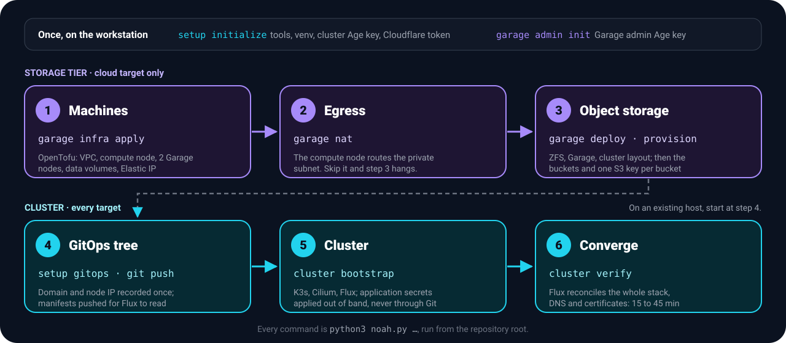

# NOAH Deployment Guide

**Version 0.1.0.** From nothing to a running platform. For day-2 work (GitOps
changes, secrets, SSO, Garage, mail, recovery) see the [Operations Guide](OPERATIONS_GUIDE.md).

<p align="center">
  
</p>

## Contents

1. [Two ways to deploy](#two-ways-to-deploy)
2. [Requirements](#requirements)
3. [Prepare the workstation](#prepare-the-workstation)
4. [Storage tier on AWS (steps 1 to 3)](#storage-tier-on-aws-steps-1-to-3)
5. [Cluster (steps 4 to 6)](#cluster-steps-4-to-6)
6. [DNS configuration](#dns-configuration)
7. [Accessing services](#accessing-services)
8. [Mail prerequisites (Stalwart)](#mail-prerequisites-stalwart)
9. [Tearing down](#tearing-down)
10. [Troubleshooting](#troubleshooting)
11. [Validation checklist](#validation-checklist)

---

## Two ways to deploy

| | AWS target | Existing host |
|---|---|---|
| Machines | created by OpenTofu (`Infra/aws/`): one compute node, two Garage nodes in a private subnet, one Elastic IP | yours; for Garage on physical machines, write `Infra/baremetal/infra-inventory.json` by hand |
| Steps | 1 to 6 | 4 to 6 (plus `garage deploy` / `provision` if you run Garage) |
| Status | validated end to end on 15 November 2026 (eu-west-3) | the original path |

**Run every command from the repository root and from the operator workstation**, not
from the compute node: the workstation is the only machine allowed to hold the Garage
administration key (see [Secrets](OPERATIONS_GUIDE.md#secrets)).

---

## Requirements

**Compute node**

| | Minimum | Recommended |
|---|---|---|
| CPU | 4 cores | 8 cores (AWS: `m6a.2xlarge`) |
| RAM | **16 GB** | **32 GB** |
| Disk | 250 GB NVMe | 2 × 500 GB NVMe, mirrored |

- Ubuntu Server 24.04 LTS is the reference. The Ansible roles use `apt` only, so the
  nodes must be Debian-family; RHEL-family systems are not supported.
- Kernel 5.10+ (Cilium eBPF). NVMe or SSD for `/var/lib/rancher/k3s`: etcd is
  write-heavy.
- **16 GB is the floor.** Authentik alone (server, worker, Redis) takes about 2 GB before
  Nextcloud, its database, Cilium, Hubble and the ingress controller.
- Multi-node: latency < 10 ms between servers. Extra servers give etcd quorum and
  scheduling capacity, **not high availability**; see
  [On availability](../README.md#on-availability).

**Garage nodes** (if you run the storage tier): 2 vCPU, 4 GB RAM, one dedicated data
disk (two, mirrored, in production), GA kernel (never HWE: ZFS must keep up with it).

**Workstation**

- Python 3.12+ (required by the pinned `ansible-core`).
- `kubectl`, `flux`, `age`, `sops`, and `tofu` (OpenTofu ≥ 1.10) for the AWS target.
  Ansible comes from the venv.
- `setup initialize` installs the system tools with **`apt` only**. On any other
  workstation (Fedora, macOS…) it warns and continues: install the binaries yourself
  (user-space copies in `~/.local/bin` are enough), then run
  `setup initialize --skip-deps`.

**Accounts and tokens**

- A domain on **Cloudflare** and an API token with `Zone → DNS → Edit` and
  `Zone → Zone → Read` on that zone only. Never a Global API key.
- A **GitHub** token (`repo` scope) so NOAH can register Flux's read-only deploy key.
  `gh auth token` works.
- For the AWS target, **AWS credentials**: `aws login` (short-lived, preferred) or
  `noah garage admin set-cloud`, which files keys in the Garage administration store.

---

## Prepare the workstation

```bash
python3 noah.py setup initialize     # venv, dependencies, Age key, SOPS config, DNS wizard
python3 noah.py garage admin init    # second Age identity + Garage administration secrets
python3 noah.py setup doctor         # check the result
```

`setup initialize` creates `.venv/`, generates `Age/keys.txt`, writes `.sops.yaml` and
runs the interactive Cloudflare wizard, which files the token in the canonical store.
Skipped the wizard (`--skip-dns-wizard`)? File the token afterwards:

```bash
python3 Scripts/security/set_cloudflare_token.py '<token>'
```

`garage admin init` creates `Age/garage-admin.txt` and `Secrets/garage-admin.enc.yaml`
(node SSH key, `rpc_secret`, admin token, owner S3 key, OpenTofu state passphrase).
**Back up both identities offline, on separate media**, before going further.

> **`setup reset` changes the Age key.** Anything encrypted with the old key can no
> longer be decrypted. Re-run `setup gitops` afterwards.

---

## Storage tier on AWS (steps 1 to 3)

Skip this section on an existing host. Background, costs and the inventory contract:
[`Infra/README.md`](../Infra/README.md).

### Step 1: machines

```bash
export TF_VAR_compute_ssh_public_key="$(cat ~/.ssh/id_ed25519.pub)"
export TF_VAR_garage_ssh_public_key="$(.venv/bin/python - <<'EOF'
from pathlib import Path
from Scripts.garage.admin_store import ensure_ssh_key, get_admin_store
print(ensure_ssh_key(get_admin_store(Path.cwd()))[1].strip())
EOF
)"

python3 noah.py garage infra init
python3 noah.py garage infra plan  --operator-cidr <your-ip>/32
python3 noah.py garage infra apply --operator-cidr <your-ip>/32
```

- The wrapper supplies the state passphrase and any credentials filed with `set-cloud`;
  it does **not** supply the two SSH public keys, hence the exports. Without them
  OpenTofu stops to prompt.
- `--operator-cidr` is the only address allowed to reach SSH and the Kubernetes API.
  `0.0.0.0/0` is refused.
- The result is `Infra/aws/infra-inventory.json`: the compute node's public IP, the
  Garage nodes' private IPs and data disks. It contains no secret.
- Planning to run mail? Add `TF_VAR_mail_enabled=true` now, see
  [Mail prerequisites](#mail-prerequisites-stalwart).

### Step 2: egress for the private subnet

```bash
python3 noah.py garage nat --from-infra Infra/aws/infra-inventory.json
```

The Garage nodes have no public address and **no egress at all** until the compute
node routes for them. Skip this and step 3 hangs instead of failing.

### Step 3: Garage

```bash
python3 noah.py garage deploy    --from-infra Infra/aws/infra-inventory.json --domain your-domain.com
python3 noah.py garage provision --from-infra Infra/aws/infra-inventory.json
python3 noah.py garage status    --from-infra Infra/aws/infra-inventory.json
```

`deploy` installs ZFS, the Garage binary, its configuration and the TLS proxy, then forms
the cluster (replication factor derived from the node count). `provision` creates the
buckets and imports one S3 key per bucket, generated in the canonical store first.
Both are idempotent. The S3 credentials reach the cluster with the other secrets at
step 5.

---

## Cluster (steps 4 to 6)

### Step 4: GitOps tree

```bash
python3 noah.py setup gitops --domain your-domain.com --node-ip <node-public-ip>
git add gitops/ && git commit -m "chore: configure domain" && git push origin main
```

`setup gitops` records the domain and the node's public IP in the canonical store and
prepares `gitops/`. `${DOMAIN}` and `${NODE_PUBLIC_IP}` stay placeholders in Git: Flux
substitutes them at apply time from the `cluster-vars` ConfigMap seeded at bootstrap.
`--node-ip` can be omitted on later runs; on AWS it is `compute_node.public_ip` from the
inventory. Add `--with-stalwart` for mail.

Application secrets are **not** written into `gitops/`; they are delivered at step 5.
Flux reads the pushed repository, so the commit must be on the branch it tracks.

> **Testing a branch other than `main`?** `cluster bootstrap --flux-branch <branch>`
> moves the `flux-system` source only. `clusters/production/noah-source.yaml`, which
> serves `gitops/`, hardcodes `branch: main`: change it on the branch too, and revert
> that commit (and the one `flux bootstrap` adds to `gotk-sync.yaml`) before merging.

### Step 5: bootstrap the cluster

```bash
GITHUB_TOKEN=<token> python3 noah.py cluster bootstrap
```

Installs K3s (embedded etcd), a first Cilium pass, the kubeconfig, FluxCD pointed at
`clusters/production/`, then applies the application secrets out of band. Defaults:

- **`--node`**: the IP recorded at step 4. When NOAH runs *on* the node itself, pass
  `--node 127.0.0.1`: an EC2 instance cannot reach its own Elastic IP.
- **`--domain`**: the recorded domain. **`--flux-repo`**: this repository's `origin`
  remote, which is what Flux must track. **`--flux-branch`**: `main`.
- **`$GITHUB_TOKEN` / `$GIT_TOKEN`** (or `--git-token`) registers the read-only deploy
  key on GitHub, GitLab or Gitea. Without it, NOAH prints the key and waits.
- **`--ssh-user` / `--ssh-key`**: `ubuntu` and your default key.
- **Multi-node:** `--multi-node --nodes a,b,c` (three or more, odd).

From a remote workstation, which is the normal case on AWS, the kubeconfig is written
encrypted to `Kube/noah-cluster.enc.yaml` and targets the address you bootstrapped
through:

```bash
sops -d Kube/noah-cluster.enc.yaml > ~/.kube/config
```

### Step 6: wait for convergence

```bash
python3 noah.py cluster verify          # waits for Flux, then probes the public URLs
python3 noah.py password show-password  # Authentik admin: akadmin
```

Flux reconciles in four ordered stages, about 15 to 45 minutes in all:

| Stage | Kustomization | Contents |
|---|---|---|
| 1 | `infrastructure` | Cilium (full configuration), ingress-nginx, cert-manager, external-dns, CoreDNS |
| 2 | `cert-manager-issuers` | Let's Encrypt production and staging issuers |
| 3 | `apps` | Authentik, Headlamp, Hubble forward-auth, their OIDC clients |
| 4 | `apps-extra` | Nextcloud, plus Stalwart when opted in |

Watch it with `watch kubectl get kustomization,helmrelease -A` or
`python3 noah.py flux logs -f`.

---

## DNS configuration

Configure DNS **before** bootstrap so external-dns can publish records as soon as the
ingresses exist.

### Option A: automatic (Cloudflare)

external-dns watches Ingress and DNSEndpoint resources and writes the A, MX and TXT
records in Cloudflare. The token comes from the canonical store (wizard or
`set_cloudflare_token.py`, see [Prepare the workstation](#prepare-the-workstation)).

```bash
kubectl logs -n external-dns -l app.kubernetes.io/name=external-dns
dig +short auth.your-domain.com
```

> [!WARNING]
> **DNS policy is `sync`, and it deletes.** external-dns runs with `policy: sync` and
> `txtOwnerId: noah`, both set in `gitops/infrastructure/external-dns/helmrelease.yaml`.
> It removes the records it owns once the matching Ingress or DNSEndpoint disappears.
> Because the owner ID is the same constant everywhere, **two NOAH clusters on one
> Cloudflare zone delete each other's records.** One zone per deployment, or change
> `txtOwnerId` first.

### Option B: manual DNS

Create A records pointing at the node's public IP, TTL 300: `auth`, `headlamp`,
`hubble`, `nextcloud`, and `mail` if Stalwart is enabled. With manual DNS the mail
MX/SPF/DKIM/DMARC records are yours to create too; the DKIM value is in
`kubectl -n flux-system get secret stalwart-dns-vars -o jsonpath='{.data.DKIM_TXT_VALUE}' | base64 -d`.

### Option C: local testing (`/etc/hosts`)

```bash
echo "<node-ip> auth.your-domain.com headlamp.your-domain.com hubble.your-domain.com" | sudo tee -a /etc/hosts
```

Let's Encrypt cannot validate names that only exist in `/etc/hosts`: expect certificate
errors.

---

## Accessing services

| Service | URL | Sign-in |
|---|---|---|
| Authentik | `https://auth.your-domain.com` | `akadmin` + `password show-password` |
| Headlamp | `https://headlamp.your-domain.com` | "Sign in with OIDC" → Authentik |
| Hubble UI | `https://hubble.your-domain.com` | Authentik forward-auth |
| Nextcloud | `https://nextcloud.your-domain.com` | "Log in with Authentik", or local `admin` |
| Stalwart *(opt-in)* | `https://mail.your-domain.com/account/` | your Authentik email → Authentik |
| Stalwart console | `https://mail.your-domain.com/admin/` | Authentik, or break-glass `admin` (`secrets canonical --show`, service `stalwart`) |

The OIDC clients (Headlamp, Nextcloud, Stalwart) and the Hubble forward-auth proxy are
**provisioned automatically** in Authentik during reconciliation. The Authentik admin's
email is `akadmin@your-domain.com`.

---

## Mail prerequisites (Stalwart)

Stalwart is **opt-in**. Enable it, then push:

```bash
python3 noah.py setup gitops --domain your-domain.com --with-stalwart
git add gitops/ && git commit -m 'feat: enable Stalwart mail' && git push
```

The flag is **not sticky**: a later `setup gitops` without it removes Stalwart from
`gitops/apps-extra/kustomization.yaml`, and Flux prunes the namespace. Its manifests and
secrets stay in place either way.

Delivering real mail needs three things no manifest can do:

1. **Inbound ports and reverse DNS.** Both are opt-in variables of `Infra/aws/`:

   ```bash
   export TF_VAR_mail_enabled=true                      # opens 25, 465, 587, 143, 993
   export TF_VAR_mail_ptr_domain=mail.your-domain.com   # PTR of the Elastic IP
   python3 noah.py garage infra apply --operator-cidr <cidr>
   ```

   AWS accepts the PTR only once `mail.your-domain.com` already resolves to the Elastic
   IP: apply it after external-dns has published the record. Without a matching PTR
   (plus SPF, DKIM and DMARC, which external-dns publishes), Gmail and Outlook reject or
   spam-folder your mail.
2. **Outbound TCP 25.** EC2 blocks it by default. Ask AWS to lift it with the
   "Request to Remove Email Sending Limitations" form; it is an account-level request.
   Until then Stalwart receives mail and queues what it sends outside.
3. **One Stalwart restart after its first configuration run:**
   `kubectl -n stalwart rollout restart statefulset/stalwart`. Stalwart starts neither
   the in-cluster relay listener (`:2525`) nor the web sign-in through Authentik until
   it restarts.

How users get a mailbox, how the notification relay works and the known limits:
[Operations Guide → Mail](OPERATIONS_GUIDE.md#mail-stalwart).

---

## Tearing down

```bash
python3 noah.py garage infra destroy --operator-cidr <cidr>
aws ec2 describe-spot-instance-requests --filters Name=state,Values=open,active --region eu-west-3
```

Keep the step 1 `TF_VAR_*` exports (and the mail ones, if set): `destroy` needs the same
variables. The second command must return nothing: a persistent Spot request that survives
relaunches an instance outside the state. The AWS provider ≥ 5.86.0 (pinned) cancels it.

**DNS records outlive the cluster.** external-dns deletes records only while it runs;
once the machines are gone, the A records still point at the released Elastic IP, which
AWS can hand to someone else. Delete them in Cloudflare, or delete the Ingresses and
DNSEndpoints and let external-dns clean up *before* destroying.

To reset only the cluster: `python3 noah.py cluster destroy --force`, then
`cluster bootstrap`. `destroy` keeps the canonical store, so the domain, node IP and
Cloudflare token survive; `--purge-secrets` wipes them too.

---

## Troubleshooting

### Node `NotReady`, Cilium in `Init:CrashLoopBackOff`

The Cilium agent cannot reach the API server. The bootstrap pass uses `127.0.0.1`; an
older clone used the node's inventory address, which the security group blocks for
anything but the operator CIDR. Fix it on the node:
`cilium upgrade --reuse-values --set k8sServiceHost=127.0.0.1`.

### `garage infra apply` fails with `InvalidParameterValue: Invalid rule description`

EC2 accepts only `a-zA-Z0-9. _-:/()#,@[]+=&;{}!$*` in security group rule descriptions.
An em dash or a `§` stops the apply half-way; fix the description and re-apply.

### Kustomizations not progressing

```bash
kubectl get kustomization -A
kubectl describe kustomization infrastructure -n flux-system
```

- **`GitRepository "noah" not found`**: `noah-source.yaml` is missing from
  `clusters/production/`. Re-run bootstrap.
- **Dependency not ready**: normal during the first rollout; stages wait on each other.
- **Stuck for 30 minutes on the health checks of an older revision** (a failed Job, for
  instance): `kubectl -n flux-system rollout restart deploy/kustomize-controller`.
- **SOPS decryption failed** (`no identity matched any of the recipients`): the material
  was encrypted with another Age key (after `setup reset`, or from a fresh clone).
  Re-run `setup gitops`, push, then `flux reconcile kustomization flux-system --with-source`.

### Services unreachable

```bash
kubectl get pods -A
kubectl get ingress -A
dig +short auth.your-domain.com
```

`cluster verify` run from the workstation probes the published address; run on the node
it probes the node's own addresses, because an EC2 instance cannot reach its Elastic IP.

### Certificate errors

```bash
kubectl get certificate -A
kubectl describe challenge -A
```

Certificates need resolvable DNS; allow about five minutes after the records appear.

### DNS records not created

```bash
kubectl logs -n external-dns -l app.kubernetes.io/name=external-dns
# "authentication error" → invalid token   "permission denied" → token scope
```

### Stalwart

| Symptom | Cause and fix |
|---|---|
| Web UI answers 502 | the ingress pod got banned as a "port scanner"; the plan trusts forwarded headers and allow-lists the pod network. Check with `stalwart-cli query BlockedIp` |
| `stalwart-config` Job never re-runs after a plan change | bump `noah/apply-plan-revision` in `provision-config-job.yaml` |
| Authentik or Nextcloud mail fails, `Connection refused` on 2525 | restart Stalwart once after the first configuration |
| SSO user gets "Invalid password" on Authentik from the Stalwart login | the typed address is not their Authentik email |

### Resource shortfall

```bash
kubectl top nodes
kubectl top pods -A
```

---

## Validation checklist

```bash
kubectl get pods -A             # all Running or Completed
kubectl get kustomization -A    # all Ready=True
kubectl get helmrelease -A      # all Ready
kubectl get certificate -A      # all Ready
```

- [ ] All Kustomizations and HelmReleases `Ready`
- [ ] DNS resolves to the node IP; HTTPS has a valid Let's Encrypt certificate
- [ ] Authentik login succeeds (`akadmin`)
- [ ] Headlamp signs in through Authentik; Hubble asks for an Authentik login
- [ ] Nextcloud offers "Log in with Authentik"
- [ ] `garage status` shows every node healthy and the five buckets
- [ ] Stalwart *(if enabled)*: ports 465 and 993 present a valid certificate, and
      `kubectl -n authentik exec deploy/authentik-worker -- ak test_email <your address>`
      lands in the Inbox
