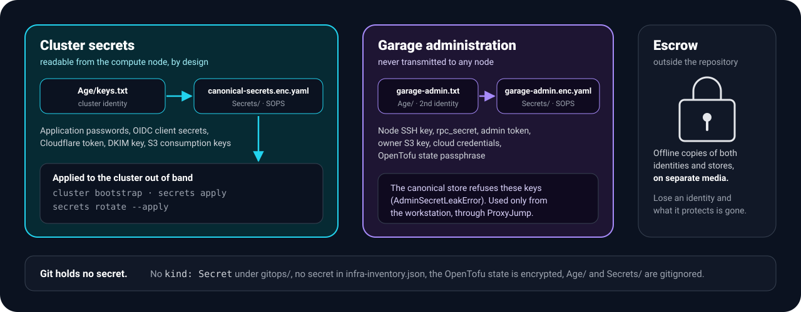

# NOAH Operations Guide

**Version 0.1.0** — day-2 operations for a running cluster. For first-time
installation see the [Deployment Guide](DEPLOYMENT_GUIDE.md).

---

## Contents

1. [The GitOps model](#the-gitops-model)
2. [Anatomy of `gitops/`](#anatomy-of-gitops)
3. [Secrets](#secrets)
4. [Garage object storage](#garage-object-storage)
5. [Mail (Stalwart)](#mail-stalwart)
6. [Network baseline](#network-baseline)
7. [Common operations](#common-operations)
8. [SSO](#sso)
9. [Scaling to HA](#scaling-to-ha)
10. [DNS day-2](#dns-day-2)
11. [Disaster recovery](#disaster-recovery)
12. [Command reference](#command-reference)

---

## The GitOps model

Git is the source of truth for every **non-secret** manifest. FluxCD's
controllers run inside the cluster, poll the repository (default every
10 minutes), and apply the result. For these manifests **you don't
`kubectl apply` in production — you `git push`.**

```bash
# Edit a manifest, then:
git add gitops/ && git commit -m "infra: bump cilium values" && git push
python3 noah.py flux sync     # optional — Flux picks it up within the interval anyway
```

Secrets are the one exception — they are delivered out-of-band, never via Git
(see [Secrets](#secrets)).

---

## Anatomy of `gitops/`

```
gitops/
├── infrastructure/
│   ├── cilium/                 # CNI + Hubble + Cilium Ingress (kube-system)
│   ├── cert-manager/           # cert-manager controller
│   ├── cert-manager-issuers/   # letsencrypt-prod / -staging ClusterIssuers
│   ├── external-dns/           # Cloudflare DNS sync
│   ├── coredns/                # cluster DNS overrides
│   └── nginx-ingress/          # ingress controller (hostPort, 80/443)
├── apps/
│   ├── authentik/              # SSO (HelmRelease; secrets applied out-of-band)
│   ├── headlamp/               # cluster UI (OIDC via Authentik)
│   └── cilium-auth/            # Cilium GUI (Hubble UI) ingress + Authentik forward-auth
├── apps-extra/
│   ├── nextcloud/              # file sync & share (OIDC via Authentik)
│   └── stalwart/               # mail server (SMTP/IMAP/JMAP) — opt-in, see below
└── network-policies/           # default-deny + allows, applied last (see Network baseline)
```

The Flux reconciliation root lives at the repo root in `clusters/production/`
(`infrastructure.yaml`, `cert-manager-issuers.yaml`, `apps.yaml`,
`apps-extra.yaml`, `network-policies.yaml`, `noah-source.yaml`). Order is enforced with `dependsOn`:

```
external-dns → cert-manager → cilium → nginx-ingress
            → authentik → cilium-auth
                        → headlamp
                        → apps-extra (nextcloud, stalwart when opted in)
                                    → network-policies (always last)
```

Stalwart is the one component absent from a default install: it is listed in
`gitops/apps-extra/kustomization.yaml` only when `setup gitops` is run with
`--with-stalwart`. Because `apps-extra` reconciles with `prune: true`, dropping
the flag on a later run deletes the `stalwart` namespace and everything in it.
Its manifests and its entries in the canonical secrets store are untouched
either way.

---

## Secrets

<p align="center">
  
</p>

The single source of truth is the SOPS/Age-encrypted
`Secrets/canonical-secrets.enc.yaml`. `Scripts/security/canonical_store.py`
loads and saves it; `Age/keys.txt` holds the private key that decrypts it.

**Secrets are never committed to Git and are not reconciled by Flux.** NOAH
renders Kubernetes Secret manifests from the canonical store and applies them
directly to the cluster:

1. **At bootstrap** — the `app-secrets` Ansible role `kubectl apply`s the
   rendered manifests (`gitops_init.render_app_secret_manifests`) right after
   Flux is installed, before Flux reconciles the namespaces.
2. **On demand** — `noah secrets apply` re-renders from the store and applies
   to the running cluster.
3. **On rotation** — `noah secrets rotate --service <svc> --apply` rotates the
   value in the store and pushes it to the cluster in one step.

Because these Secrets are unmanaged by Flux, they are **not** pruned or
drift-corrected — re-run `secrets apply` to re-sync after a manual change.

Authentik picks up a changed value automatically (Flux watches its
`authentik` values Secret via `valuesFrom`). Env-mounted consumers (Headlamp,
external-dns, cert-manager) read their Secret at startup, so restart them after
a rotation, e.g. `kubectl rollout restart deploy -n headlamp`.

> **Back up `Secrets/canonical-secrets.enc.yaml` *and* `Age/keys.txt`
> offline.** Together they are the only copy of your secret material; the
> generated values are unrecoverable if both are lost.

### Rotating a secret

```bash
# Rotate in the store and push to the cluster in one step — no git, no re-bootstrap:
python3 noah.py secrets rotate --service authentik --apply

# Rotate the Authentik admin password specifically:
python3 noah.py password new
python3 noah.py secrets apply
```

Inspect the store (read-only):
```bash
python3 noah.py secrets canonical --show
python3 noah.py secrets validate
```

---

## Garage object storage

Garage is the **one component that runs outside the cluster**, on machines the
compute node cannot reach. That is not a deployment detail: it is what makes
the ZFS-snapshot immutability strategy worth anything. Operate it as if that
separation were the feature, because it is — a Garage reachable from the
compute node works perfectly and protects nothing.

Specification: [`Specs/Garage.md`](../../Specs/Garage.md).
Infrastructure: [`Infra/README.md`](../Infra/README.md).

### The three secret domains

| Domain | Contents | Store | Readable from the compute node |
|---|---|---|---|
| **Cluster** | application secrets, **S3 consumption keys** | `Secrets/canonical-secrets.enc.yaml` | **yes, by design** |
| **Garage administration** | node SSH key, `rpc_secret`, admin token, `owner` S3 key, cloud provider credentials, OpenTofu state passphrase | `Secrets/garage-admin.enc.yaml` | **no** |
| **Escrow** | offline copies of both identities | out of the repository | — |

The cluster's Age key is handed to the compute node as the `sops-age` Secret in
`flux-system`, so **everything in the canonical store is readable from that
node** — by anyone with `cluster-admin`, a container escape, or root. The S3
consumption keys are there on purpose: being read by the cluster is what they
are for, and their compromise is an accepted risk covered by the ZFS snapshots,
precisely because Garage cannot grant write without granting delete.

Everything that grants access to the Garage **machines** lives in the second
store, encrypted to `Age/garage-admin.txt` — an identity that is **never
transmitted to any node**. The canonical store refuses those keys outright; it
is not a convention, it is a `AdminSecretLeakError`.

```bash
python3 noah.py garage admin init           # creates Age/garage-admin.txt
python3 noah.py garage admin show           # names only, never values
python3 noah.py garage admin show --field rpc_secret
```

> **Escrow — back up `Age/garage-admin.txt` OFFLINE, separately from
> `Age/keys.txt`.** Two identities, two backups, and they must not travel
> together: a single medium holding both recreates in the storage cupboard
> exactly the separation the code maintains. Losing this one makes every Garage
> administration secret unrecoverable — and `Age/keys.txt` cannot decrypt it,
> which is the whole point.

### What must never happen

| Never | Why |
|---|---|
| Put `rpc_secret`, the admin token or the node SSH key in the canonical store | Delivers the storage tier along with the compute node; cancels the immutability strategy |
| Give Garage and the cluster the same SSH key | Same effect, without any other thing going wrong. `noah garage deploy` refuses it |
| Copy the administration SSH key onto the compute node "for jump-host convenience" | `ssh -J` needs nothing on the hop but a running sshd: it *carries* the connection, it does not hold the key |
| Attach an instance profile to a Garage node | Puts stealable credentials back on the storage tier, with IMDS as the way to steal them |
| Set `bpf.masquerade: true` on Cilium | eBPF host routing bypasses netfilter, the masquerading rule stops applying, and the Garage nodes lose egress **with no message at all** |
| Serve S3 in the clear without deciding to | `--no-tls` exists and is explicit. A silent default is the failure this project already fixed once |

### Deploying

```bash
# 0. machines (cloud target only — see Infra/README.md)
python3 noah.py garage infra apply --operator-cidr 203.0.113.4/32

# 1. egress routing on the compute node — A BOOTSTRAP PREREQUISITE
python3 noah.py garage nat --from-infra Infra/aws/infra-inventory.json

# 2. ZFS, binary, configuration, cluster formation
python3 noah.py garage deploy --from-infra Infra/aws/infra-inventory.json

# 3. buckets and S3 keys
python3 noah.py garage provision --from-infra Infra/aws/infra-inventory.json

# 4. deliver the S3 credentials to the cluster (existing out-of-band channel)
python3 noah.py secrets apply

python3 noah.py garage status --from-infra Infra/aws/infra-inventory.json
```

On physical machines, write `infra-inventory.json` by hand (see
`Infra/baremetal/`) and skip step 1 with `--skip-nat`, or pass `--nodes a,b`
directly.

**Step 1 is blocking and it does not show.** Where the Garage nodes sit in a
private subnet they have *no egress at all* until the compute node routes for
them, and steps 2 and 3 then fail by **hanging** rather than by refusing.

### Buckets and keys

| Bucket | Consumer | Key in the store | Delivered to the cluster |
|---|---|---|---|
| `nextcloud-objects` | Nextcloud primary storage | `garage-nextcloud` | namespace `nextcloud` |
| `pg-wal` | CNPG / Barman | `garage-pgwal` | namespace `cnpg-system` |
| `velero` | Velero | `garage-velero` | namespace `velero` |
| `logs` | VictoriaLogs / Loki | `garage-logs` | namespace `observability` |
| `git-mirror` | GitOps mirror | `garage-gitmirror` | **no manifest** — consumed outside the cluster |

**One key per bucket, never a shared key.** Garage distinguishes only
read / write / owner: granting write grants deletion. Per-key partitioning
limits the blast radius; it does not cancel it — that is what the snapshots
are for.

`garage-gitmirror` deliberately has no Kubernetes Secret: the mirror is
produced by the backup tooling from the operator workstation, not by a pod.

**The credentials are generated by NOAH and imposed on Garage**, never the
reverse. `garage key import` accepts an imposed id and secret, so the store
stays the source of truth and no secret can become unreadable after creation.
A Garage rebuilt from nothing re-imports the same credentials from the restored
store — which is what makes destroying and rebuilding the platform safe.

Re-running `garage provision` creates no duplicate key and modifies no bucket.

**Rotating an S3 key is not automated yet.** It is a two-sided sequence —
regenerate in the store, re-import, re-grant on the bucket, remove the old key —
that `secrets rotate` cannot orchestrate on its own. Planned for lot 10 with
`backup` / `restore`.

### Going from two nodes to three

The development topology is **two nodes, replication factor 2**; production is
**three nodes, factor 3**. Two nodes are enough to reproduce CRDT resurrection
and coordinated rollback — the mechanism the immutability strategy depends on —
without immobilising three machines.

**What two nodes do not give you: production quorum arithmetic and tolerance to
losing a node.** At factor 2 the write quorum is 2, so **losing one node stops
writes**. That is acceptable while validating a mechanism and unacceptable in
production. These are availability properties, not integrity ones — but they
must be settled before any client deployment.

Moving to three is a change of inventory and of `garage layout assign`, not a
rewrite. **The replication factor is never entered: it is derived from the
number of nodes** (a factor above the node count would only be refused by
`layout apply`, after `garage.toml` had already been written to every machine).

```bash
# 1. a third machine, in the SAME availability zone as the other two
python3 noah.py garage infra apply --operator-cidr <cidr> --node-count 3

# 2. redeploy: zones become site-a, site-a, site-b and the factor becomes 3
python3 noah.py garage deploy --from-infra Infra/aws/infra-inventory.json

# 3. check the layout converged with no divergence
python3 noah.py garage status --from-infra Infra/aws/infra-inventory.json
```

Also required before production, and not delivered by moving to three nodes:

- **two disks per Garage node**, ZFS mirror. Snapshots are local and Garage does
  not replicate them; the development single-disk shortcut would destroy the
  point of the mirror;
- **GA kernel, never HWE** — a kernel ahead of OpenZFS support makes the pool
  unreachable at the next reboot;
- a **real TLS certificate** in front of the S3 API; the role generates a
  self-signed one, which encrypts the segment but authenticates nothing.

> Do not confuse the **Garage zones** (`site-a` / `site-b`, internal placement
> labels) with the **cloud availability zone**, which is single by
> construction: an EBS volume is bound to its zone and a stopped Spot instance
> restarts in its own, so spreading the machines would silently break the
> ability of a node to find its pool again.

---

## Mail (Stalwart)

Stalwart is opt-in (`setup gitops --with-stalwart`); first-time prerequisites (ports,
PTR, outbound 25, the one restart) are in the
[Deployment Guide](DEPLOYMENT_GUIDE.md#mail-prerequisites-stalwart).

**Giving someone a mailbox.** Create the user in Authentik with the email
`<name>@<domain>`. The mailbox appears in Stalwart the first time they sign in (web
interface, IMAP or JMAP); mail sent to them before that bounces. They
sign in at `https://mail.<domain>/account/` with that address.

**Changing the configuration.** Stalwart's settings live in its datastore and
are applied by the `stalwart-config` Job from the plan in
`gitops/apps-extra/stalwart/apply-plan-configmap.yaml`. Flux re-creates that Job
only when the Job itself changes, so **every edit of the plan must also bump
`noah/apply-plan-revision`** in `provision-config-job.yaml` — otherwise the new
plan is silently never applied.

**Notifications.** Authentik (`authentik.email` values) and Nextcloud
(`mail.config.php`) send their mail through an in-cluster relay listener of
Stalwart on port **2525**, published only by the `stalwart` ClusterIP Service
(no `hostPort`). On that port alone Stalwart accepts mail without
authentication and relays it; the rules are keyed on the port, not on the
client address, because external connections reach Stalwart masqueraded
behind a pod-network address. Consequences:

- any pod in the cluster can send mail through the relay;
- relay mail is not spam-filtered (like authenticated submission); otherwise
  notifications from our own domain fail SPF/DMARC and land in Junk;
- the public port 25 still refuses to relay (`5.1.2 Relay not allowed`);
- the relay answers only after Stalwart has restarted once following its first
  configuration run (see the Deployment Guide).

Test it:

```bash
kubectl -n authentik exec deploy/authentik-worker -- ak test_email <address>
```

**Web UI behind the ingress.** The plan sets `useXForwarded` and allow-lists
the pod network (`10.0.0.0/8`, Cilium's cluster pool). Without it, Stalwart
attributes every web request to the ingress controller pod, and the first
Internet scanner gets that pod banned — the web UI then answers 502.

**Web interface sign-in (`/account/`, `/admin/`).** The plan sets
`Application.oauthClientId` to the `stalwart` Authentik client, which is a
**public** client (PKCE, no secret) registered with the two web interface
callbacks (`/admin/oauth/callback`, `/account/oauth/callback`). The user types
an address, the web interface discovers the provider for its domain
(`/api/discover/<address>`) and sends the browser to Authentik with that
address as `login_hint`. Like the relay listener, the client id only reaches
the served pages after a Stalwart restart following the first plan run.

**The mailbox address is the Authentik email.** Stalwart's OIDC directory
reads the `email` claim, so a user's mailbox is exactly the address set on
their Authentik account. That is also what makes the web sign-in work (the
typed address, passed as `login_hint`, identifies the user in Authentik) and
what makes mail Authentik sends to a user land in their mailbox. Consequences:

- to give someone a NOAH mailbox, set their Authentik email to
  `<name>@<domain>`; a user whose Authentik email is elsewhere (Gmail, …) has
  no mailbox;
- the bootstrap admin is `akadmin@<domain>` (`bootstrap_email`), not
  `admin@<domain>`;
- **Authentik group names become Stalwart group principals** (`claimGroups`):
  the `admin` group occupies `admin@<domain>`. A user whose email equals
  `<group name>@<domain>` cannot sign in ("Account ID from directory does not
  correspond to a user account") — keep group names and mailbox names apart.

> **Known limit — client addresses on the mail ports.** The mail ports are
> `hostPort`s, and connections reach Stalwart source-NATed to a pod-network
> address. Stalwart therefore never sees the real sender address on SMTP/IMAP:
> SPF checks on inbound mail and automatic IP bans cannot work there. Fixing it
> needs `hostNetwork` or the PROXY protocol; not done yet.

---

## Network baseline

`gitops/network-policies/` holds a cluster-wide **default-deny** and one explicit allow
per legitimate flow (Cilium policies). It is reconciled by its own Flux Kustomization,
`network-policies`, which depends on every other one: it is always the last thing to
land. Stalwart's policies ship with `gitops/apps-extra/stalwart/` instead, so they exist
only when Stalwart does.

The same policies give Hubble its layer-7 view: HTTP and DNS flows appear in the Cilium
GUI (`https://cilium.<domain>`) because the allows route them through Cilium's proxies.

### Audit first, enforce later

The baseline ships in **audit mode** (`policyAuditMode: true` in
`gitops/infrastructure/cilium/helmrelease.yaml`): verdicts are logged, nothing is
dropped. Let it run 24 to 48 hours under real use (SSO login, certificate renewal, a
Flux reconciliation, a Nextcloud upload), then look at what enforcement would drop:

```bash
kubectl -n kube-system exec ds/cilium -- hubble observe --verdict AUDIT --type policy-verdict -f
```

Check first that the default-deny bites: an audit with no `AUDIT` verdict at all usually
means an inert policy, not a complete one. From a throwaway pod,
`curl https://example.com` must show up as an `AUDIT` verdict.

Every legitimate flow reported there needs an allow in `gitops/network-policies/`
before going further. To enforce, set `policyAuditMode: false` in the HelmRelease and
push. Then confirm nothing legitimate is dropped:

```bash
kubectl -n kube-system exec ds/cilium -- hubble observe --verdict DROPPED -f
```

> **Never switch modes with `cilium config`.** The HelmRelease owns that setting and
> restores the committed value at its next reconciliation, which would move the
> cluster into enforcement in the middle of an audit.

### Rollback

From least to most drastic:

```bash
git revert <commit that set policyAuditMode: false>     # back to audit
flux suspend kustomization network-policies              # freeze the current state
flux delete kustomization network-policies               # prune every policy
```

### Editing the policies

- **A policy targets the pod port, never the Service port.** `hubble-ui` is 8081 (not
  80), `authentik-server` 9000, `headlamp` 4466. A wrong port raises no error: the
  allow matches nothing and the flow is silently dropped. Check with
  `kubectl -n <ns> get pod -l <selector> -o jsonpath='{.items[0].spec.containers[*].ports[*].containerPort}'`.
- **A change that adds a data path ships its allow in the same change**, otherwise it
  breaks at its first reconciliation under enforcement.
- **Never allow** `169.254.169.254` (cloud metadata), nor ports 22, 3901 and 3903
  towards the Garage segment: their absence is the protection.
- Stalwart's relay on 2525 has no authentication; its allow list (Authentik, Nextcloud)
  is its only protection. Do not widen it.

`pytest Tests/test_network_policies.py` checks these invariants without a cluster.

---

## Common operations

### Add an application

```bash
mkdir -p gitops/apps/myapp
# Add: namespace.yaml, helmrepository.yaml, helmrelease.yaml, kustomization.yaml
echo "  - myapp" >> gitops/apps/kustomization.yaml
git add -A && git commit -m "apps: add myapp" && git push
python3 noah.py flux sync     # optional
```

If the app needs a secret, add it to the canonical store and deliver it with
`secrets apply` — do not commit it.

### Pause / resume a HelmRelease

```yaml
# in gitops/apps/<svc>/helmrelease.yaml
spec:
  suspend: true
```

`git push`, do the manual work, then revert to `suspend: false`. This is the
recommended workflow for a major Cilium upgrade: suspend, run `cilium upgrade`
manually, then unsuspend.

### Force reconciliation

```bash
python3 noah.py flux sync                         # everything
flux reconcile helmrelease authentik -n authentik # one resource
```

### Watch what's happening

```bash
python3 noah.py flux status     # snapshot of every Flux resource
python3 noah.py flux logs -f    # live tail across controllers
python3 noah.py cluster status  # nodes + etcd + Flux roll-up
```

### Tune the reconciliation cadence

The default `interval: 10m` suits most workloads. Drop it on a specific
Kustomization for faster rollouts, but don't go below 30 s (the controller
spends more time list-watching the API than reconciling):

```yaml
spec:
  interval: 1m
```

---

## SSO

Authentik is the identity provider. Every client is **provisioned automatically** during
reconciliation by `gitops/apps/authentik_provisioner.py`, run from one Job per service;
it is idempotent and there is no manual Authentik step. The bootstrap admin is
`akadmin`, email `akadmin@<domain>`.

| Service | Mechanism | Authentik provider | Notes |
|---|---|---|---|
| Headlamp | OIDC, confidential | `headlamp-oidc` | callback `/oidc-callback`; no cluster-admin binding by default, so a "Forbidden" view before sign-in is expected |
| Hubble UI | forward-auth (proxy provider) | `cilium-proxy` | defined in `gitops/apps/cilium-auth/`; Hubble's own ingress is disabled |
| Nextcloud | OIDC, confidential (`user_oidc`) | `nextcloud-oidc` | local `admin` stays as break-glass |
| Stalwart | OIDC, **public** (PKCE) | `stalwart-oidc` | web interface callbacks `/admin/oauth/callback` and `/account/oauth/callback`; tokens also accepted over IMAP/SMTP (OAUTHBEARER) and JMAP |

The Nextcloud provisioning Job also creates an Authentik group `admin` holding `akadmin`;
Nextcloud maps the `groups` claim, so its members are Nextcloud administrators. Stalwart
does not inherit roles from groups: its plan gives `akadmin` the administrator role
directly.

Verify:

```bash
AUTHENTIK_BOOTSTRAP_TOKEN=<token> python3 noah.py test headlamp --domain your-domain.com
AUTHENTIK_BOOTSTRAP_TOKEN=<token> python3 noah.py test cilium --domain your-domain.com
curl https://auth.your-domain.com/application/o/headlamp/.well-known/openid-configuration
```

The token is `bootstrap_token` of the `authentik` service in the canonical store
(`secrets canonical --show`). `noah test sso` expects to run on the node: it needs
`helm` and in-cluster Redis access.

---

## Scaling to HA

A single-node cluster runs embedded etcd as a single member. To grow to a
3-node quorum:

```bash
python3 noah.py cluster add-nodes --primary <existing-node-ip> --nodes node2,node3 \
  --ssh-user ubuntu --ssh-key ~/.ssh/id_ed25519
```

New servers join the etcd cluster; quorum then tolerates one node failure.
Keep inter-node latency below 10 ms.

---

## DNS day-2

external-dns reconciles A records from Ingress resources. To rotate the
Cloudflare token, update it in the canonical store and re-deliver:

```bash
python3 noah.py secrets rotate --service cloudflare --apply
kubectl rollout restart deploy -n external-dns
```

The policy and owner ID are set in
`gitops/infrastructure/external-dns/helmrelease.yaml` (`policy: sync`,
`txtOwnerId: noah`) — edit and push to change either. There is no environment
variable for them.

> [!WARNING]
> `sync` deletes the records external-dns owns when their Ingress or
> DNSEndpoint goes away, and the owner ID is the same constant in every NOAH
> deployment. Two clusters sharing one Cloudflare zone will fight over the same
> records. Use one zone per deployment unless you change `txtOwnerId` first.

Subdomains are literals in the Ingress manifests (`auth.`, `headlamp.`,
`cilium.` — only `${DOMAIN}` is substituted by Flux). To change one, edit the
manifest and push:

```bash
# e.g. gitops/apps/authentik/authentik-ingress.yaml → host: "sso.${DOMAIN}"
git add gitops/ && git commit -m "apps: move authentik to sso." && git push
```

> `config override` and the `NOAH_*_SUBDOMAIN` variables only affect the
> `config` command group's output (process-local); they do **not** change what
> Flux deploys.

---

## Disaster recovery

| Scenario | Recovery |
|---|---|
| Single-node cluster gone | Re-run `noah cluster bootstrap`; Flux reconstructs all state. |
| One HA node down | Quorum holds; replace the node and run `noah cluster add-nodes`. |
| `Age/keys.txt` lost, backup intact | Restore the backup as `Age/keys.txt`, then re-run bootstrap. |
| Canonical store **or** Age key lost | Generated secrets are unrecoverable. Restore the offline backup of `Secrets/canonical-secrets.enc.yaml` **and** `Age/keys.txt`. |
| GitOps repo gone | Restore from any clone — Flux re-reconciles. Secrets are unaffected (not in Git); re-run `secrets apply` if needed. |
| Garage machines gone | Rebuild them (`garage infra apply`), then `garage deploy && garage provision`. The **same** S3 credentials are re-imported from the canonical store, so nothing in the cluster has to change. |
| `Age/garage-admin.txt` lost | Every Garage administration secret is unrecoverable, and `Age/keys.txt` **cannot** decrypt them — that separation is the feature. Restore the offline escrow copy. |

**Back up regularly — but not into one archive.** The cluster domain and the
Garage administration domain must not travel together: a single medium holding
both identities recreates in the storage cupboard exactly the separation the
code maintains.

```bash
# Cluster domain
tar -czf noah-cluster-$(date +%Y%m%d).tar.gz \
    Age/keys.txt Secrets/canonical-secrets.enc.yaml .sops.yaml

# Garage administration domain — separate medium, separate custody
tar -czf noah-garage-admin-$(date +%Y%m%d).tar.gz \
    Age/garage-admin.txt Secrets/garage-admin.enc.yaml
```

---

## Command reference

| Group | Command | Purpose |
|---|---|---|
| `setup` | `initialize` / `gitops` / `doctor` / `reset` / `update-sops` | Environment + gitops prep |
| `cluster` | `bootstrap` / `add-nodes` / `status` / `verify` / `destroy` | Cluster lifecycle |
| `flux` | `sync` / `status` / `logs` | Drive the FluxCD controllers |
| `garage` | `deploy` / `provision` / `status` / `nat` / `admin *` / `infra *` | Object storage outside the cluster |
| `secrets` | `apply` / `rotate` / `canonical` / `generate` / `regenerate` / `validate` / `init` | Manage the canonical store |
| `password` | `show-password` / `new` | Authentik admin credentials |
| `certificates` | `deploy-manager` / `generate-certs` / `list` | TLS certificate helpers |
| `test` | `sso` / `headlamp` / `cilium` | Post-deploy service checks |
| `config` | `domains` / `show` / `override` / `helm-values` | Inspect dynamic-domain config |
| *(top-level)* | `status` | Status of all deployed services |

Run `python3 noah.py <group> --help` for the full option list of any command.
